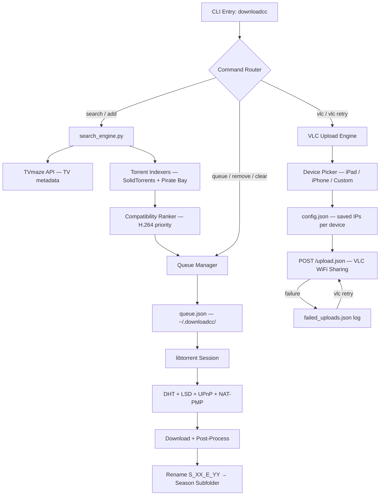

# 📺 downloadcc — Terminal-based Media Downloader with Wireless VLC Transfer

[](LICENSE)
[](#)
[](#)
[](#)

A fully interactive terminal-based media downloader to search movies and TV shows, select seasons and episodes, download via native `libtorrent`, and wirelessly push files to VLC on iPad/iPhone.

---

## 📖 Table of Contents
- [Key Features](#-key-features)
- [System Architecture](#%EF%B8%8F-system-architecture)
- [Quick Setup & Installation](#-quick-setup--installation)
- [How to Use](#-how-to-use)
- [Configuration](#%EF%B8%8F-configuration)
- [File Structure](#-file-structure)
- [License](#-license)

---

## ✨ Key Features

- **100% Terminal-Based CLI**: Numbered interactive selection menus without the need for arrow keys or a GUI.
- **TV Show Metadata Integration**: Interfaces with the TVmaze API to dynamically load shows, seasons, and full episode lists.
- **Strict Title Matching**: Custom regex validation ensures search results exactly match your target title, eliminating false positives.
- **iPad/iPhone-Compatible Video Profiles**: Results rank H.264/.mp4 streams highest and deprioritize HEVC/x265, AV1, and 10-bit formats for guaranteed out-of-the-box playback on iOS.
- **High-Speed Peer Discovery**: DHT, Local Service Discovery (LSD), UPnP, and NAT-PMP all enabled for maximum torrent connectivity.
- **Automatic Post-Processing**: Organizes downloads into season subfolders and renames files to the clean S_XX_E_YY.ext convention automatically.
- **Multi-Device VLC Wireless Upload**: Upload files directly to VLC over WiFi, saving IP addresses for future use.
- **Smart Retry for Failed Uploads**: Re-upload only the files that failed in the last batch.
- **Persistent Background Queue**: Download multiple shows/movies sequentially with live progress, automatic resume, and self-healing torrent switching.

---

## ⚙️ System Architecture

Data flow from user command line input through torrent download processing stages to wireless device output.



---

## 🚀 Quick Setup & Installation

### Prerequisites (Zero-Dependency Setup)
This guide assumes a clean machine with **no pre-installed tools**.

```cmd
winget install --id Python.Python.3.12 -e --accept-source-agreements --accept-package-agreements
winget install --id Git.Git -e --accept-source-agreements --accept-package-agreements
```

🔍 **Verification Command**:
```cmd
python --version
```
*Expected Output*: `Python 3.12.x`

### Clone & Install
```bash
git clone https://github.com/IamOumarIbrahim/movies-shows-downloader.git
cd movies-shows-downloader
pip install requests beautifulsoup4 libtorrent pyinstaller
```

### Run
```bash
python downloadcc.py
```

---

## 🛠️ How to Use

1. Run the downloader by typing `python downloadcc.py "Movie or Show Name"`.
2. Select a result by typing its corresponding number and pressing Enter.
3. Wait for the live progress indicator to reach 100% completion.

```bash
# Example command
python downloadcc.py "Mr. Robot"
```

---

## ⚙️ Configuration

`config.json` (created automatically in `~/.downloadcc/config.json` on first use of VLC upload):

```json
{
  "ipad_ip": "192.168.1.100",
  "iphone_ip": "192.168.1.101"
}
```

| Field | Description |
| :--- | :--- |
| `ipad_ip` | The saved IP address of your iPad running VLC. |
| `iphone_ip` | The saved IP address of your iPhone running VLC. |

---

## 📁 File Structure

downloadcc/
├── downloadcc.py - Main interactive CLI entry point
├── search_engine.py - TVmaze API + torrent indexer crawling engine
├── installer.iss - Inno Setup compiler configuration
├── MoviesAndShowsInstaller.exe - Compiled standalone Windows installer
├── LICENSE - MIT License text
└── README.md - Project documentation

---

## 📄 License
This repository is licensed under the [MIT License](LICENSE).
