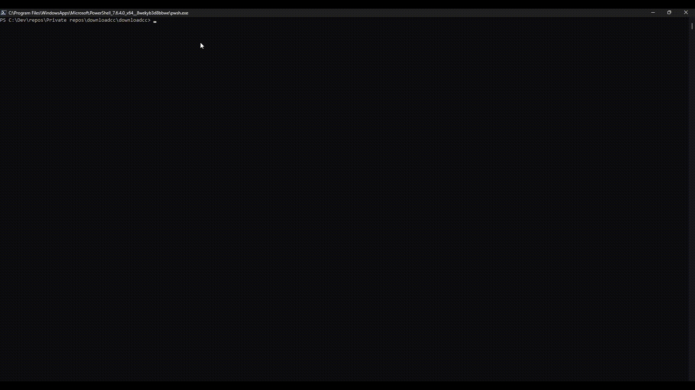
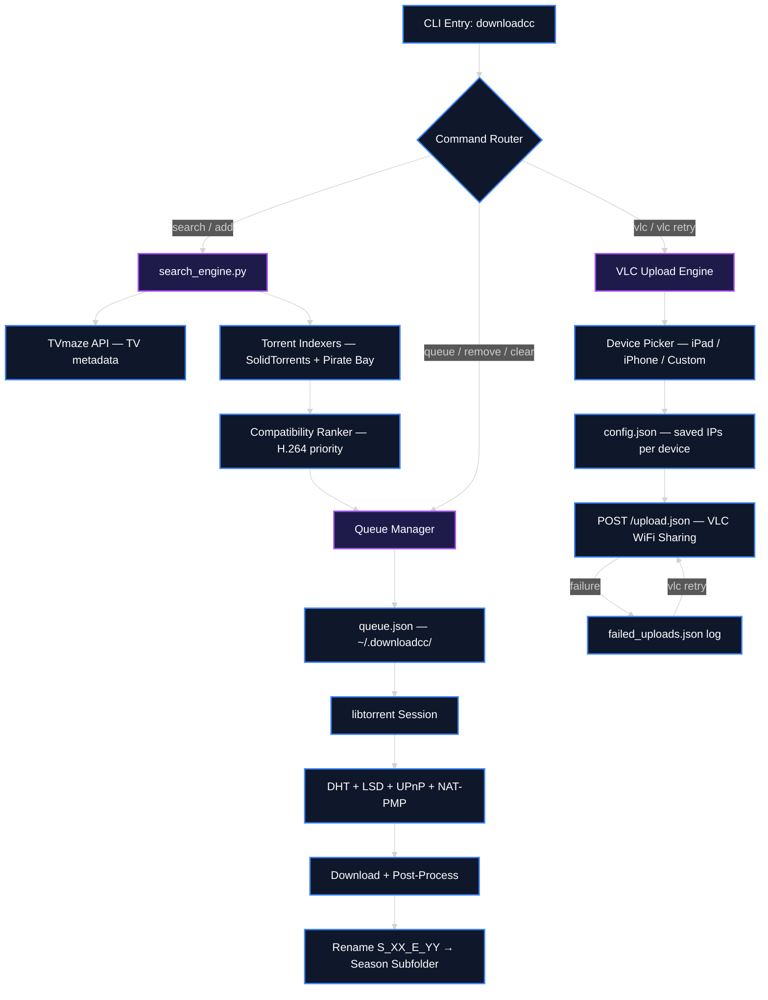

<div align="center">
  <h1>downloadcc</h1>
  <p><strong>Terminal-based Media Downloader with Wireless VLC Transfer</strong></p>

  <p>
    <a href="https://www.python.org/"></a>
    <a href="LICENSE"></a>
    <a href="https://libtorrent.org/"></a>
  </p>

  <p>
    
  </p>
</div>

downloadcc is a fully interactive terminal-based media downloader that searches movies and TV shows, selects seasons and episodes, downloads via native `libtorrent`, and wirelessly pushes files to VLC on iPad/iPhone.

<br />

## Table of Contents
- [What is downloadcc?](#what-is-downloadcc)
- [Key Features](#key-features)
- [System Architecture](#system-architecture)
- [Setup & Installation](#setup--installation)
- [How to Use](#how-to-use)
- [Reference Tables](#reference-tables)
- [Scope & Limitations](#scope--limitations)
- [File Structure](#file-structure)
- [Troubleshooting](#troubleshooting)
- [Contributing](#contributing)
- [License](#license)

---

## What is downloadcc?

Instead of manual torrenting and tedious file transfers via cables or cloud drives, downloadcc automates the process:
- **100% Terminal-Based CLI**: Numbered interactive selection menus without the need for arrow keys or a GUI.
- **TV Show Metadata Integration**: Interfaces with the TVmaze API to dynamically load shows, seasons, and full episode lists.
- **Multi-Device VLC Wireless Upload**: Upload files directly to VLC over WiFi, saving IP addresses for future use.

---

## Key Features

- **Strict Title Matching**: Custom regex validation ensures search results exactly match your target title, eliminating false positives.
- **iPad/iPhone-Compatible Video Profiles**: Results rank H.264/.mp4 streams highest and deprioritize HEVC/x265, AV1, and 10-bit formats for guaranteed out-of-the-box playback on iOS.
- **High-Speed Peer Discovery**: DHT, Local Service Discovery (LSD), UPnP, and NAT-PMP all enabled for maximum torrent connectivity.
- **Automatic Post-Processing**: Organizes downloads into season subfolders and renames files to the clean S_XX_E_YY.ext convention automatically.
- **Smart Retry for Failed Uploads**: Re-upload only the files that failed in the last batch.
- **Persistent Background Queue**: Download multiple shows/movies sequentially with live progress, automatic resume, and self-healing torrent switching.

---

## System Architecture

Data flow from user command line input through torrent download processing stages to wireless device output.



---

## Setup & Installation

### Option A: 1-Click Setup (Windows)
```cmd
winget install --id Python.Python.3.12 -e --accept-source-agreements --accept-package-agreements
winget install --id Git.Git -e --accept-source-agreements --accept-package-agreements
```
This installs Python 3.12 and Git using winget, ensuring you have the required base dependencies.

### Option B: Manual Installation

```bash
git clone https://github.com/IamOumarIbrahim/movies-shows-downloader.git
cd movies-shows-downloader
pip install requests beautifulsoup4 libtorrent pyinstaller
```

**Verification Command**:
```bash
python --version
```
*Expected Output*: `Python 3.12.x`

---

## How to Use

1. Run the downloader by typing `python downloadcc.py "Movie or Show Name"`.
2. Select a result by typing its corresponding number and pressing Enter.
3. Wait for the live progress indicator to reach 100% completion.

```bash
# Example command to search and download Mr. Robot
python downloadcc.py "Mr. Robot"
```

---

## Reference Tables

### Configuration Schema (`~/.downloadcc/config.json`)

| Field | Description | Type |
| :--- | :--- | :--- |
| `ipad_ip` | The saved IP address of your iPad running VLC. | String |
| `iphone_ip` | The saved IP address of your iPhone running VLC. | String |

---

## Scope & Limitations

- **iOS Format Prioritization**: Specifically optimizes for H.264 formats which might deprioritize higher quality HEVC/4K rips.
- **Network Dependency**: Requires local WiFi network connectivity to the iOS device for VLC transfers.

---

## File Structure

```
downloadcc/
├── downloadcc.py                - Main interactive CLI entry point
├── search_engine.py             - TVmaze API + torrent indexer crawling engine
├── demo.gif                     - Demo preview animation
├── installer.iss                - Inno Setup compiler configuration
├── MoviesAndShowsInstaller.exe  - Compiled standalone Windows installer
├── LICENSE                      - MIT License text
└── README.md                    - Project documentation
```

---

## Troubleshooting

| Issue | Root Cause | Resolution |
| :--- | :--- | :--- |
| Download stalled at 0% | No peers available or firewall blocking DHT | Wait a few minutes for peer discovery, or ensure python/downloadcc is allowed through Windows Firewall. |
| VLC upload fails | IP address changed or device screen is locked | Wake up device, open VLC, check network IP, and use the VLC retry command. |

---

## Contributing

The easiest way to contribute is by adding new torrent indexers to `search_engine.py`. Simply implement a new scraper function and append its results to the main search pool.

---

## License
MIT License © 2024 [IamOumarIbrahim](https://github.com/IamOumarIbrahim)

## Powered By
[libtorrent](https://libtorrent.org/) · [TVmaze](https://www.tvmaze.com/api)

<div align="center">

If downloadcc solved your media downloading and transferring needs, a star helps other people find it.

</div>
